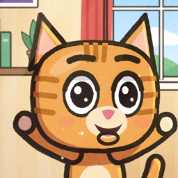
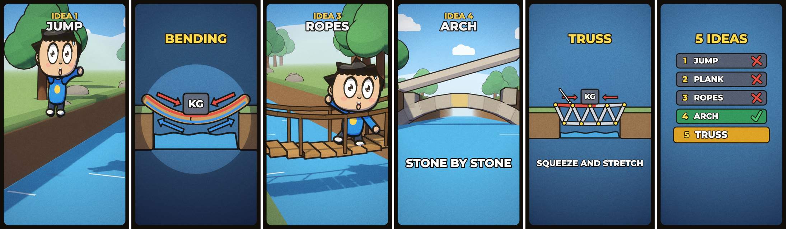
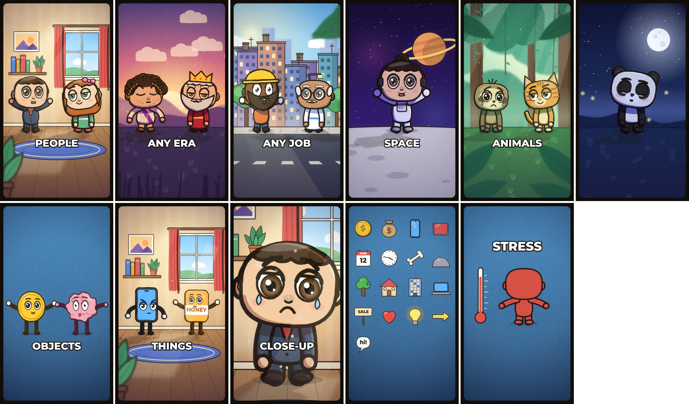
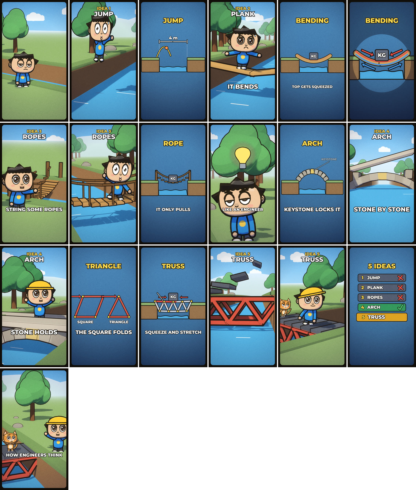
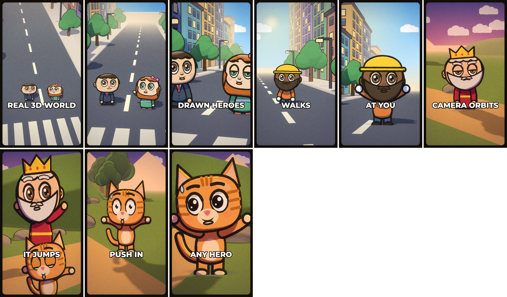

<!-- prettier-ignore -->
<div align="center">



# cutout-toon

*Cartoon videos drawn entirely in JavaScript, by Claude Code*

[](https://docs.claude.com/en/docs/claude-code/plugins)
[](https://nodejs.org)
[](https://threejs.org)
[](LICENSE)

[Features](#features) • [Install](#install) • [Usage](#usage) • [Write a video](#write-a-video) • [Examples](#examples) • [Limits](#limits)



</div>

Ask Claude for a video on any topic and get a vertical mp4 with hand-drawn heroes, lit sets, real 3D camera moves and diagrams that build themselves. Nothing comes from an image or video model: every character, background, diagram and camera move is code, so the same hero looks the same in every video and any frame can be fixed and re-rendered.

The repository has two parts:

- **An engine** (`engine/`): a canvas 2D character rig, lit 2D sets, three.js 3D stages, an animated diagram kit and named camera moves. A whole video is one `shots.js` file.
- **A skill** (`skills/cutout-toon/`): the steps Claude follows to turn a script into that file, from reference images and a draw sheet to the final render.

## Features

- **Vertical video:** 1080x1920 at 30 fps, ready for Shorts, Reels and TikTok.
- **One house style:** big-head heroes with a wobbling ink line, coloured shadows and rim light taken from the set they stand in, plus glow, vignette and paper grain.
- **Any hero:** people, animals and talking objects share one spec. 14 heroes are ready (office worker, emperor, scientist, king, astronaut, sloth, panda, cat, coin, brain, phone and more), and a new one takes a few lines.
- **Acting for free:** breathing, blinking, eye darts, and hair, ears, tails and hats that trail every move. You write only the walks, jumps, waves, speech and emotions.
- **2D + 3D:** flat sets with parallax, and three.js stages where the camera orbits and heroes walk toward the lens.
- **Named camera moves:** push in, pull out, crane, truck, follow, low angle, dolly zoom, whip and fly to, plus `chain`, `dutch` and `hit` to combine, tilt and shake them.
- **Explanations that build step by step:** struts, arrows, flowing force dots, rulers, counters and labels appear one step per caption.
- **Building piece by piece:** a bridge or a wall goes up one part at a time while the camera moves with it.
- **A linter:** `check` catches camera and pose jumps, shots longer than 4.5 s, gaps in the timeline and captions that overlap or run past three words, before anything is drawn.



## Install

In a terminal:

```bash
claude plugin install cutout-toon --marketplace dimqsh/cutout-toon
```

Or inside a Claude Code session:

```text
/plugin install cutout-toon --marketplace dimqsh/cutout-toon
```

> [!TIP]
> On Claude Code older than 2.1.275, add the marketplace first:
> `claude plugin marketplace add dimqsh/cutout-toon`, then `claude plugin install cutout-toon@cutout-toon`.

> [!IMPORTANT]
> The renderer needs [ffmpeg](https://ffmpeg.org) on your `PATH` (`brew install ffmpeg` on macOS). On the first render Claude installs the rest itself with `npm run setup` in the plugin's `engine` folder: Playwright, three.js and a headless Chromium.

## Usage

Start Claude Code and ask for a video:

```text
/cutout-toon:cutout-toon why the Roman emperor executed the man who invented unbreakable glass, my script is in story.md
```

You can also just describe it ("make a 2D cartoon about how bridges hold weight"); the skill triggers on requests for a cartoon, cutout or 2D animation.

Claude then:

1. Splits the script into beats of 1.5 to 3 s.
2. Finds reference images for every hero, set and prop, and writes a draw sheet.
3. Builds the cast from the nearest ready hero and compares it with the references.
4. Writes the shots: a named camera move per shot, a diagram card for every "why", builds piece by piece.
5. Runs `check`, looks at stills, fixes what is flat or covered by a caption, and renders the mp4.

> [!NOTE]
> The output is a silent video. The skill mentions companion skills for scripts, voice and sound (`/toon-story`, `/higgsfield-faceless-script`) and for finding references (`/browse`); they are not part of this plugin. Without them, give Claude your script and expect a silent mp4.

### Render by hand

Clone the repository to run the engine without Claude:

```bash
git clone https://github.com/dimqsh/cutout-toon.git
cd cutout-toon
npm run setup --prefix engine
node engine/render.mjs examples/office video office.mp4
```

| Command | Result |
|---|---|
| `node engine/render.mjs <project> check` | Lints the shot list. Prints `PROBLEM` lines and exits with 1 if anything is wrong. |
| `node engine/render.mjs <project> stills 0.5,3.2 [outDir]` | PNG stills at those seconds. |
| `node engine/render.mjs <project> sheet [out.jpg] [times]` | A contact sheet, one frame per shot by default. |
| `node engine/render.mjs <project> video [out.mp4] [fps] [from] [to]` | The mp4, or a time range of it. |

`CRF=22` before a `video` command gives a smaller file (the default, 17, is a master; the paper grain is costly to compress). Rendering takes about 0.4 s a frame on a Mac, so a 40 s video takes about 8 minutes. 3D stages need a GPU; on a machine without one, put `GL=swiftshader` before the command.

## Write a video

A project is a folder with a `shots.js`. This one is a complete 4-second video:

```js
import { go, mix, EMO, GROUND, walk, say, cam2, CAT } from '/engine/src/index.js';

const cat = { hero: CAT, at: [300, GROUND + 6], size: 640, seed: 3 };

export const DURATION = 4;
export const SHOTS = [
  { start: 0, end: 4, set: 'room',
    cam: cam2.pushIn([540, 1000], { zoom: [1, 1.15], dur: 3.5 }),          // a slow push in
    actors: [{ ...cat, pose: lt =>
      say(                                                                 // lip flap from 2.4 to 3.6 s
        walk(                                                              // walks 260 px to the right, 0.2 to 1.8 s
          go(mix(EMO.calm, { head: { turn: 0.5 } }), lt, [[2.2, EMO.happy, { dur: 0.3 }]]),   // calm, then happy at 2.2 s
          lt, 0.2, 1.8, 260),
        lt, [[2.4, 3.6]]) }] },
];
export const CAPTIONS = [[0.3, 1.8, 'hello'], [2.4, 3.8, 'I am drawn']];
```

```bash
node engine/render.mjs my-video video hello.mp4
```

The full API is in [`skills/cutout-toon/references/engine.md`](skills/cutout-toon/references/engine.md): shot and actor fields, the hero spec, motion helpers, sets and props, 3D stages, camera moves, the diagram kit and the staging rules.

## Examples

| Folder | Shows | Length |
|---|---|---|
| [`examples/cast`](examples/cast) | The ready heroes on every 2D set, one shot each | 11 s |
| [`examples/office`](examples/office) | 2D sets: walk-ins, speech, a jump, a wave, a prop, close-ups, wipe cuts | 12.5 s |
| [`examples/sloth`](examples/sloth) | Animal heroes in the jungle, with a card shot | 14 s |
| [`examples/street3d`](examples/street3d) | 3D stages (street, meadow): camera orbits, a hero walking toward the lens | 15 s |
| [`examples/bridge`](examples/bridge) | A full explainer: four bridges (three assembled piece by piece), eight diagram cards, eleven named camera moves | 65.8 s |

The rendered videos are not stored in the repository; build any of them with the `video` command.

<details>
<summary>Every shot of the bridge example</summary>



</details>

<details>
<summary>The 3D stages</summary>



</details>

## Project layout

```text
.claude-plugin/          plugin and marketplace manifests
skills/cutout-toon/      SKILL.md (the steps Claude follows) and the engine reference
engine/render.mjs        check, stills, sheet, video
engine/src/hero.js       the character rig and hero spec
engine/src/motion.js     walk, jump, say, wave, idle acting, follow-through
engine/src/sets.js       2D sets            engine/src/props.js     props
engine/src/stage3d.js    3D stages and piece-by-piece builds
engine/src/cams.js       named camera moves engine/src/diagram.js   the diagram kit
engine/src/index.js      public API, frame composer, linter
engine/tests/            unit tests (npm test --prefix engine)
examples/                five working projects
```

## Limits

- Portrait 1080x1920 only, and no audio.
- Heroes are drawn from the front and in 3/4; there is no profile or back view, and from straight above a hero is a thin line.
- The mouth flaps while a hero speaks but is not synced to the words.
- On a 3D stage the sky is a painted backdrop and does not turn with the camera.

## Credits

- The camera vocabulary and default timings follow the camera family of [Awesome AI Motion](https://github.com/gongnyang/awesome-ai-motion) (MIT); the code is our own.
- [three.js](https://threejs.org), [Playwright](https://playwright.dev) and [ffmpeg](https://ffmpeg.org) do the 3D, the browser and the encoding.
- Captions use Montserrat ExtraBold (SIL Open Font License).
